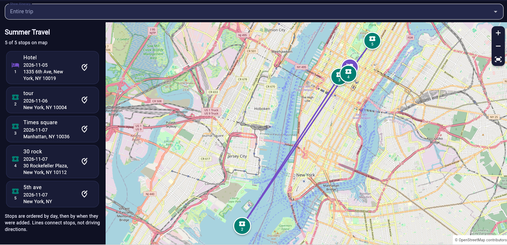
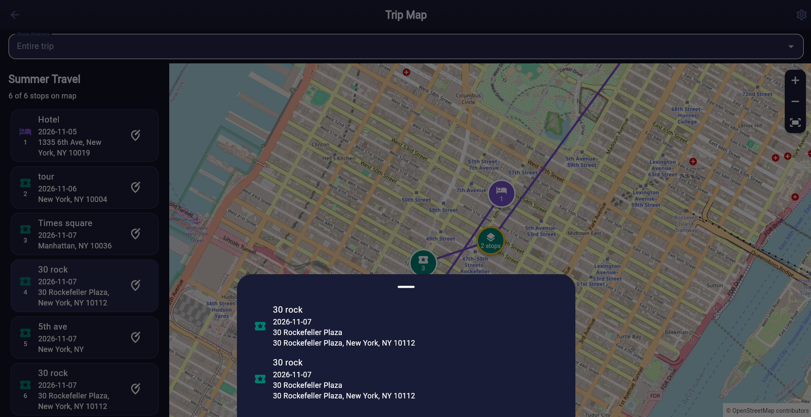
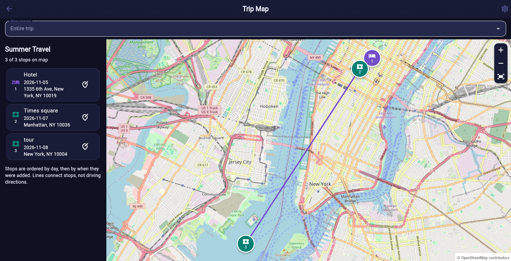

# Manual Test Report

## Test Information

| Field | Details |
| --- | --- |
| Test ID | FR 202-4 |
| Test Name | Map View Implementation |
| Requirement ID(s) | FR-202 |
| Test Level | Integration |
| Tester | Jack Burky |
| Date | 11/5/2026 |
| Priority | Medium |

## Objective

This test is to verify the functionality of the map view feature. It is difficut to automatically test correctness so, it will be manually done.

## Preconditions

List anything that must be true before performing the test.

- The map view functionality must be fully complete
- The map view must be deployed to the live enviroment

## Test Environment

| Field | Details |
| --- | --- |
| Platform | Web |
| Browser | Chrome |
| Operating System | Windows 11 |
| Application Version / Branch | Version 0.6.0 |

## Test Steps

| Step | Action | Expected Result | Actual Result | Status |
| --- | --- | --- | --- | --- |
| 1 | Create a new itinerary and add 5+ unique locations | All 5 locations populate without issue | 5 Locations (All in New York) Correctly Populated | Pass |
| 2 | Create a new itinerary and add duplicate locations | The duplicate should be noted as being duplicated | Duplicate was flagged as "Two Stops" which can be exapanded | Pass |
| 3 | Create a new itinerary and add 2 locations. View map and add 2 new locations. Insure they are added | The new locations should populate | New location (5th Ave.) Was added successfully | Pass |
| 4 | Create a new itinerary and add 2 locations. View map and remove 1 location. Insure they are removed | The location should be removed | 5th Ave was removed | Pass  |
| 5 | Create a new itinerary and add 2 locations. Move one location to a new day. Ensure the order changes | the order of the connections should change | Statue of Liberty Tour moved after all other events| Pass |
| 6 | Create a new itinerary and add a location with no geo data. Ensure it is not plotted | The map should be empty | Impossible to add without Geo Data due to search results | Pass |

## Overall Result

**Status:** Pass

All outcomes displayed as expected.

## Issues / Bugs Found

None

## Evidence / Notes

