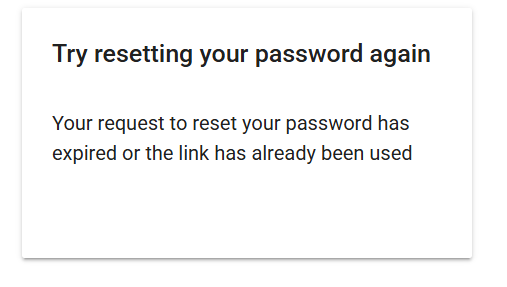

# Manual Test Report

## Test Information

| Field | Details |
| --- | --- |
| Test ID | 301-7 |
| Test Name | Password Reset Link Expired |
| Requirement ID(s) | FR-301 |
| Test Level | Unit |
| Tester | Jack Burky |
| Date | 11/5-6/2026 |
| Priority | Low |

## Objective

This test verifies that an expired password reset link will not work.

## Preconditions

- The User must have a valid existing account.

## Test Environment

| Field | Details |
| --- | --- |
| Platform | Web |
| Browser | Chrome |
| Operating System | Windows 11 |
| Application Version / Branch | v0.6.0 |

## Test Steps

| Step | Action | Expected Result | Actual Result | Status |
| --- | --- | --- | --- | --- |
| 1 | Request Password Reset and wait < 24 Hours | The Password Reset Fails | Reset requested at 9:41 PM. At 10:33 AM, the link if invalid| Pass / Fail |

## Overall Result

**Status:** Pass

12 Hours later, the password reset link is invalidated

## Issues / Bugs Found

None

## Evidence / Notes

