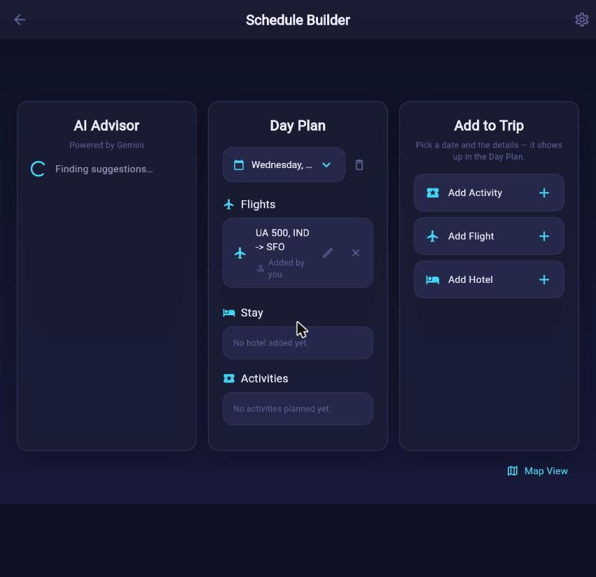
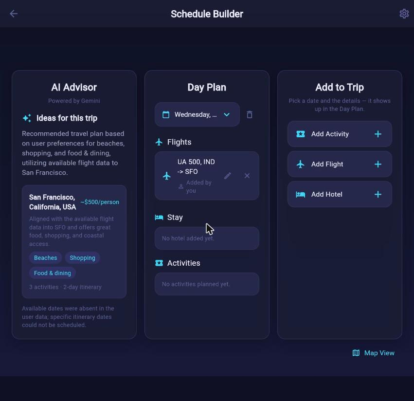
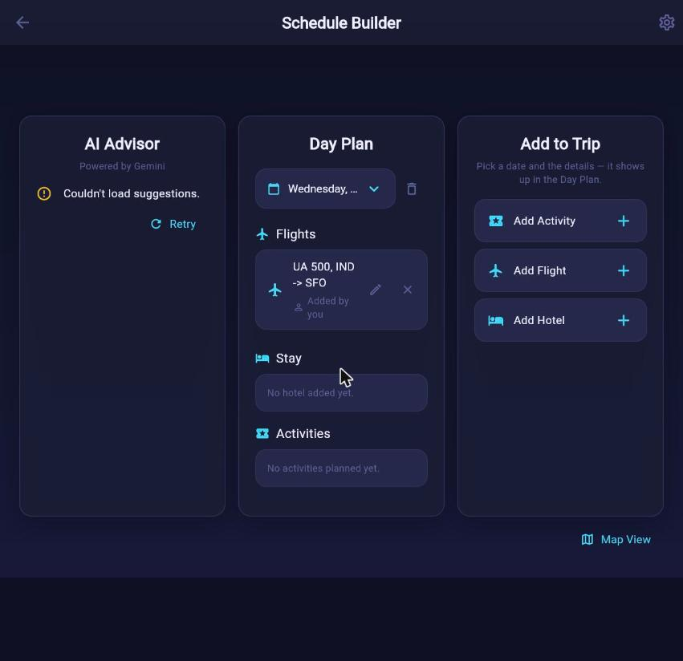

# Manual Test Report

## Test Information

| Field | Details |
| --- | --- |
| Test ID | MT-104-1 |
| Test Name | Schedule Builder AI Advisor: suggestions load, and fail clearly when the proxy is down |
| Requirement ID(s) | FR-104 |
| Test Level | System |
| Tester | Ethan Bar |
| Date | 11/01/2026 |
| Priority | High |

## Objective

Verify the AI Advisor flow added in [PR #165](https://github.com/PrishaB/Syncinary/pull/165) (#108) from start to finish. A signed-in group member opens a group's schedule, and the AI Advisor panel loads Gemini trip suggestions through the proxy's `POST /recommendations` endpoint (PR #162). When the proxy is unreachable, the panel should show a clear error instead of hanging or crashing.

## Preconditions

- The proxy runs locally on `http://localhost:3000` with a valid `GEMINI_API_KEY`, `GEMINI_MODEL=gemini-3.5-flash-lite`, `FIREBASE_PROJECT_ID=syncinary-48881`, and a Firebase service-account key in `GOOGLE_APPLICATION_CREDENTIALS`.
- The Flutter web app runs locally with `flutter run -d web-server --web-port 5050` and uses a local `lib/firebase_options.dart`.
- The tester is signed in to an account that has saved preferences and is the admin of a group (`TestGroup`).
- The group's schedule has at least one item: flight UA 500, IND → SFO.

## Test Environment

| Field | Details |
| --- | --- |
| Platform | Web |
| Browser | Google Chrome 156 |
| Operating System | Windows 11 Home |
| Application Version / Branch | work-issue-108-advisor-suggestions @ ba0552b (Flutter 3.47.2, Node 24.13.1) |

## Test Steps

| Step | Action | Expected Result | Actual Result | Status |
| --- | --- | --- | --- | --- |
| 1 | With the proxy running, open `http://localhost:5050` while signed in. | The My Groups page lists the user's groups. | My Groups showed `TestGroup` (Admin). | Pass |
| 2 | Open `TestGroup`, then click **Plan Itinerary**. | The Schedule Builder opens with the AI Advisor, Day Plan and Add to Trip panels. The Day Plan shows the existing flight. | The Schedule Builder opened. The Day Plan showed "UA 500, IND -> SFO". The AI Advisor showed a spinner and "Finding suggestions…" (screenshot 1). | Pass |
| 3 | Wait for the AI Advisor to finish. | The panel shows Gemini suggestions based on the group's preferences and schedule. | Within 8 s, "Ideas for this trip" appeared. It showed a summary, a San Francisco, California suggestion (~$500/person) with Beaches, Shopping and Food & dining tags, "3 activities · 2-day itinerary", and a note that no dates were available (screenshot 2). The suggestion matches the scheduled IND → SFO flight. | Pass |
| 4 | Stop the proxy and confirm nothing is listening on port 3000. Go back to the group page and click **Plan Itinerary** again. | The AI Advisor shows a clear error message instead of loading forever or crashing. The rest of the Schedule Builder still works. | The panel showed a warning icon, "Couldn't load suggestions." and a **Retry** button. The Day Plan and Add to Trip panels still loaded and responded (screenshot 3). | Pass |
| 5 | With the proxy still stopped, click **Retry**. | The request is tried again, and the same error appears without a crash. | The error message and Retry button appeared again. The app stayed responsive. | Pass |

## Overall Result

**Status:** Pass

With the proxy running, the AI Advisor loaded relevant Gemini suggestions for the group's schedule. With the proxy stopped, it showed a clear "Couldn't load suggestions." message with a Retry button, and the rest of the page kept working.

## Issues / Bugs Found

None.

## Evidence / Notes

1. AI Advisor loading (proxy running):

   

2. Suggestions loaded (proxy running):

   

3. Error shown with the proxy stopped:

   

Notes:

- The first attempt, before setup was finished, also showed "Couldn't load suggestions." It had two causes. First, the Gemini key was brand new and not yet active, so Gemini returned 401. Second, `GOOGLE_APPLICATION_CREDENTIALS` was missing, so the proxy couldn't read Firestore and returned 503 `upstream_error`. Both were environment setup problems, not app defects. The proxy logged each failure without crashing, and the steps above were run after both were fixed.
- The error message is the same whether the proxy is unreachable, Gemini fails, or the backend is misconfigured. This is deliberate: `suggestions_section.dart` shows a generic message rather than the raw failure text. It's clear enough for users, but it doesn't say which of these happened. Possible improvement: show "Can't reach the suggestion service" when the request fails at the network level.
