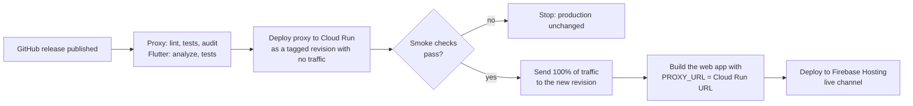

# Deployment: Syncinary

Syncinary is deployed as a web app, so there's nothing to install. Open **<https://syncinary.com>** in any modern browser, then follow the [Getting Started tutorial](tutorial.md) to sign up and create or join a group.

## What is deployed

The live version is **v0.6.0**, the "Map View and Admin Release", published Nov 6, 2026. Each GitHub release is a deployed version.

| Part | Where it runs | Address |
|------|---------------|---------|
| Web app (Flutter, release build) | Firebase Hosting, project `syncinary-48881` | <https://syncinary.com> (also <https://syncinary-48881.web.app>) |
| Backend proxy (Node 22 / Express, Docker) | Google Cloud Run, service `syncinary-proxy`, region `us-central1` | Called by the web app; not used directly |
| Accounts and data | Firebase Authentication and Cloud Firestore | Accessed through the Firebase SDK |

**Available in the live deployment:**
- Accounts with email verification.
- Groups, invites and admin roles.
- Travel preferences.
- The shared Schedule Builder, with suggest and approve.
- The trip map.
- Expense tracking with equal splits.
- Flight, hotel and airport search.

**AI recommendations are not live.** The deployed proxy has no `/recommendations` route. The Schedule Builder's AI Advisor panel is a placeholder, and the suggestions card on Flight Search shows "Couldn't load suggestions." The recommendation pipeline is on `main` but hasn't been released yet. The same goes for custom percentage expense splits.

Syncinary is a browser application, not a mobile app, so it isn't published to the Google Play Store or the Apple App Store. Flutter can build mobile versions from the same code, but the supported product is the web app.

## How a release is deployed

Publishing a full (non-prerelease) GitHub release starts the release workflow, `.github/workflows/firebase-hosting-pull-request.yml`. Nothing is deployed by hand.

1. **Checks.** The proxy is linted, tested and audited (`npm audit`). The Flutter app is analyzed and tested. A failure stops the release.
2. **Proxy deploy.** Cloud Build builds the proxy's Docker image from source, and Cloud Run deploys it as a new revision that receives no traffic yet. It runs on 0 to 3 instances, so it scales to zero when idle.
3. **Smoke checks** run against that revision. Neither one uses a billed API:
    - `/hotels` with no parameters must return 400.
    - `/airports?q=IND` must find the IND airport.
4. **Promote.** Only a revision that passes both checks receives production traffic. A failed check leaves the previous version serving users.
5. **Web deploy.** The Flutter web app is built with the proxy's URL compiled in (`--dart-define=PROXY_URL=...`) and published to Firebase Hosting's live channel.

## Configuration and secrets

No API key is stored in the source code, the Docker image or the web build.

| Secret | Stored in | Used for |
|--------|-----------|----------|
| `SERPAPI_KEY` | Google Secret Manager | Flight, hotel and place search |
| `GOOGLE_MAPS_API_KEY` | Google Secret Manager | Airport name search (Places API) |
| `FIREBASE_OPTIONS_DART` | GitHub Actions secret | Firebase client config for the web build |
| `FIREBASE_SERVICE_ACCOUNT_SYNCINARY_48881` | GitHub Actions secret | Lets the workflow deploy to Cloud Run and Hosting |

The proxy runs as its own service account, which can read only its two secrets. The one-time Google Cloud setup (service accounts, roles and secrets) is in [`proxy/README.md`](../proxy/README.md#production-releases-cloud-run).

## Checking a deployment

After a release:

- [ ] Open <https://syncinary.com>, sign in, and open a group.
- [ ] Search flights and hotels, and an airport by city name (for example, Indianapolis).
- [ ] Add items in the Schedule Builder and confirm they appear for other members.
- [ ] Open the trip map and confirm items with locations appear.

## Running locally

1. Start the proxy as described in [`proxy/README.md`](../proxy/README.md). It runs at `http://localhost:3000`.
2. In `syncinary/`, generate `lib/firebase_options.dart` with `flutterfire configure --project=syncinary-48881`. The file is gitignored.
3. Run `flutter run -d chrome`.
