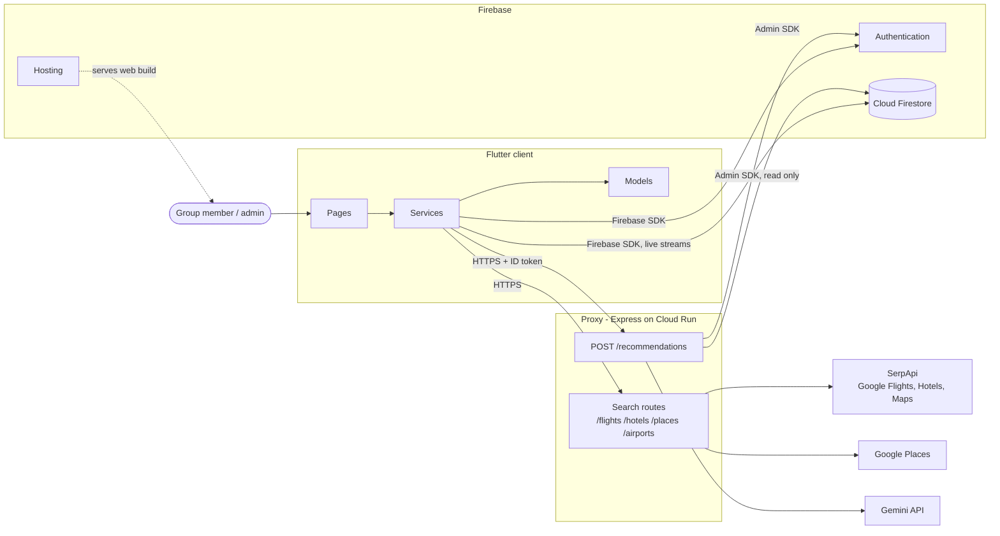
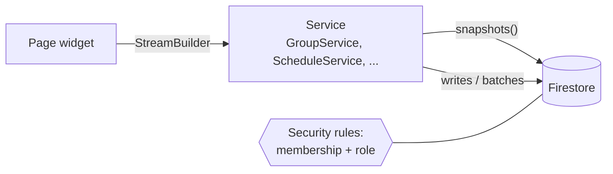
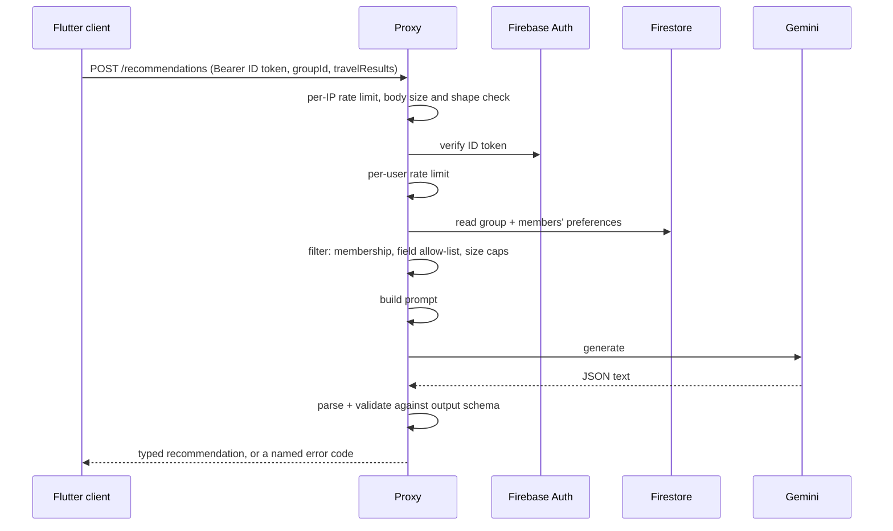
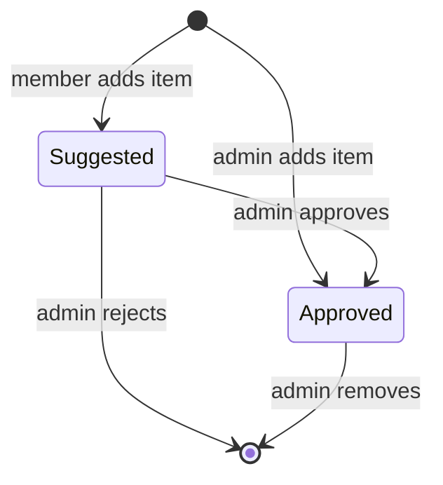

# Explanation: Syncinary

This document explains why Syncinary is built the way it is: its architecture, the decisions behind it, and what those decisions cost. It is for technically capable readers. For step-by-step use, see the [Tutorial](tutorial.md); for exact APIs, fields and settings, see the [Reference](Reference.md).

## System Overview

Syncinary is a group trip planner. A group shares a single live itinerary, an expense tracker and a set of travel preferences. Members can search flights, hotels and places, and they get AI recommendations based on the whole group's preferences.

The system has three parts:

- **A Flutter client** (web first, with mobile builds from the same code). It holds all of the UI and talks to Firebase directly.
- **Firebase** (Authentication, Cloud Firestore, Hosting). It holds user accounts and every piece of persistent data, and it serves the web app.
- **A small Node/Express proxy** on Cloud Run. It holds the API keys and is the only part that calls external services: SerpApi, Google Places and Gemini.

> **Live deployment:** this document describes the code on `main`. The live deployment at <https://syncinary.com> runs release v0.6.0, which doesn't include AI recommendations (the `/recommendations` route and the AI Advisor) or custom percentage expense splits. See [Deployment](deployment.md).

The guiding idea is to keep the server as thin as possible. Firebase covers what a traditional backend would do (accounts, storage, live sync, access control), so the proxy exists for only two reasons: keeping secrets off the client, and running the recommendation pipeline in a place users can't tamper with.

## Architecture Diagrams

### Overall system

This updates the container diagram from our design document. Vertex AI became the Gemini API, kayak.com deep links became SerpApi searches inside the app, and the proxy is now a separate service.

The sections below look at three parts of this picture more closely.

### Data path: client and Firestore

Most features never touch the proxy. Groups, the schedule, expenses, invites and preferences are read and written straight from the client through the Firebase SDK. Firestore security rules decide what each user may do.

### Recommendation request

The AI Advisor sends the group id, the search and the group's current schedule. The proxy checks the caller, loads the group's data on the server, trims it down, and only sends the result on to Gemini once that's done.

### Itinerary roles

Every group has exactly one admin. Everyone else is a member. Members suggest items, and the admin decides what goes on the itinerary.

## Key Components

### Flutter client (`syncinary/`)

The client is organised in three layers:

- **Pages** (`pages/`): one screen per file.
- **Services** (`services/`): data access to Firestore, Auth and the proxy.
- **Models** (`models/`): plain classes that convert to and from Firestore documents and JSON.

Pages never call Firestore themselves; they go through a service. Every service takes optional `FirebaseFirestore` and `FirebaseAuth` instances, so the widget tests run against `fake_cloud_firestore` and `firebase_auth_mocks` without a live backend.

`AuthGate` sits at the root and sends each user to login, email verification or their groups, depending on their auth state. Screens subscribe to Firestore streams, so a change made by one member shows up on everyone else's screen without a refresh.

### Authentication

Accounts use Firebase Authentication with email and password, and email verification is required before a user gets into the app. The same Firebase identity is used in three places: by Firestore rules on the client side, by the proxy (which checks the ID token on `/recommendations`), and in every document (`addedBy`, `memberIds`).

### Data model (Cloud Firestore)

- **`users/{uid}`**: the profile plus that user's travel preferences (budget, activities, dietary needs, pace).
- **`groups/{groupId}`**: stores its members twice.
    - `memberIds` is a list, used for "my groups" queries.
    - `members` is a map from uid to `{username, email, role}`, used for display and role checks.
- **Subcollections under each group:** `scheduleDays`, `scheduleItems` and `expenses`. A group's data can then be read with one listener per subcollection and deleted along with the group.
- **`invites` and `inviteCodes`:** top-level collections, because they must be found by someone who isn't a member yet.

### Schedule Builder

The Schedule Builder is the main planning screen. It has three panels:

- **AI Advisor:** recommendations for the group. This is a placeholder in the live deployment.
- **Day Plan:** the approved itinerary for the selected day.
- **Add to Trip:** adds activities, flights and hotels.

Days are created automatically when the first item lands on them. Items can carry a confirmed location, and those items are drawn on the trip map: `flutter_map` with OpenStreetMap tiles, plus a small retrying tile client to cope with dropped connections.

### Expenses

Each expense records who paid and who shares it. Shares are either equal or custom percentages. The live deployment (v0.6.0) supports only equal splits. Amounts are worked out in whole cents, and any leftover cents go to the largest fractional shares, so the preview and the saved totals always agree.

### Proxy (`proxy/`)

The proxy is a stateless Express app on Cloud Run, packaged with Docker. It does two jobs:

- **Search routes**:
    - `/flights`, `/hotels` and `/places` forward requests to SerpApi's Google Flights, Hotels and Maps engines.
    - `/airports` looks for an exact IATA code in a bundled OurAirports catalog first. If there's no match, it falls back to Google Places and keeps only results it can match to a known airport.
- **`/recommendations`**: the only route with authentication. It is described below.

### LLM recommendation pipeline

The pipeline is merged on `main` but isn't in the live deployment yet (v0.6.0).

The pipeline has four stages. Each stage returns a result object and never throws.

1. **Filter** (`llmDataFilter.js`):
    - checks that the caller belongs to the group;
    - keeps only allowed fields;
    - caps strings at 300 characters, arrays at 15 items and members at 25;
    - rejects payloads over 20 KB.
2. **Prompt** (`recommendationPrompt.js`): turns the payload into a prompt. The prompt tells the model to treat everything in the payload as untrusted user data and to ignore any instructions inside it, to resist prompt injection.
3. **Generate** (`geminiClient.js`): calls Gemini, by default `gemini-3.5-flash-lite`, with a 20-second timeout.
4. **Validate** (`parseRecommendationResponse`): rejects any reply that isn't valid JSON or doesn't match the output schema.

The Dart `Recommendation` model mirrors the output schema. The client therefore receives either typed data or a named error such as `timeout` or `rate_limited`, never raw model text.

### Delivery and CI

**On every push and pull request**, CI runs these jobs:

- Flutter analyze and test.
- Proxy lint, test and `npm audit`.
- A Syft SBOM, checked with Grype.
- gitleaks, OSV-Scanner and CodeQL.

**On a published GitHub release**, the proxy deploys to Cloud Run. The web app is then built with that proxy's URL (`PROXY_URL`) and deployed to Firebase Hosting.

## Design Decisions

### Flutter and Dart for the client

The team needed a web app and wanted mobile without a second codebase. Flutter builds both from one widget tree, and FlutterFire gives first-class Firebase support. Widget tests run headless in CI, and we rely on them heavily for UI behaviour.

### Firebase instead of a custom backend

The trade study on authentication (AUTH-1, score 9 of 10) chose Firebase Authentication for its security and its fit with the rest of the stack. Firestore followed from that choice. It gives us live listeners for the shared itinerary, offline-tolerant SDKs, and server-enforced rules, with no server to run.

The biggest consequence is architectural: business rules live in two places, the client services and the Firestore security rules. One example is that only the admin can approve an item.

### A thin proxy for external APIs

The API integration trade study chose a centralized backend aggregator (Design A) over sending users to external booking sites. The main reason was reliability: results stay inside Syncinary, where the group can compare them and add them to the trip.

In practice the aggregator is deliberately thin. It holds the keys, checks inputs, trims upstream responses and returns them. It keeps no state, which keeps it cheap to run on Cloud Run and easy to test with injected `fetch` stubs.

### LLM plus rule-based filtering

The LLM trade study scored "LLM + rule-based filtering" (D1) highest, at 8.2. It beat a fully integrated LLM (D2, 6.6) and cached batch processing (D3, 7.6).

The current pipeline is D1 with rules on both sides of the model:

- **Before Gemini**, deterministic code decides what the model may see.
- **After Gemini**, a strict schema decides what the client will accept.

This keeps cost and latency down: the prompt is small and there is a single model call. It also makes output safe to render, and failures easy to explain to users.

### The proxy loads group data itself

The client sends only the group id and its own search results. The proxy then reads the group and its members' preferences from Firestore with the Admin SDK, after verifying the caller's ID token. Any `uid` in the request body is ignored.

This stops a client from claiming someone else's preferences, or asking about a group it doesn't belong to. The error messages sent back are fixed strings, so Gemini or Firestore errors can't leak data.

### Fixed roles with suggest and approve

The group management trade study chose a hybrid (design 003, score 7.7): fixed roles, plus a limited set of preferences. Syncinary has exactly two roles, admin and member.

Members can add to the plan, but their items arrive as suggestions until the admin approves them. This keeps one person accountable for the final itinerary without stopping anyone from contributing.

### Gemini API over Vertex AI, and SerpApi over deep links

The design document named Vertex AI and kayak.com deep links. We changed both:

- **Gemini API:** it needs only an API key held by the proxy, with no service-account setup in the client path.
- **SerpApi:** one key covers flights, hotels and maps search. Its Google Flights results carry booking tokens, so a user can go from a result inside Syncinary to a booking page.

The client file `amadeus_service.dart` is still named after an earlier provider.

## Tradeoffs and Limitations

- **Security rules aren't versioned with the code.** The Firestore rules are maintained in the Firebase console. A feature that depends on them, such as stopping members from writing approved items, can't be reviewed or tested in a PR alongside the code.
- **The client chooses some sensitive values.** For example, the client sets an item's status (suggested or approved) based on the user's role. That is safe only because the rules re-check it, which is the same dependency as the previous point.
- **The member list is stored twice.** `memberIds` and `members` must agree after every write, including role changes. Group operations have to update both together, preferably in a transaction. BUG-002 (#189) shows the risk of not doing so: if a member leaves while an admin transfer to them is in progress, the trip is left with no admin.
- **Search routes are unauthenticated.** `/flights`, `/hotels`, `/places` and `/airports` accept any caller, and CORS is open. Anyone who finds the proxy URL can use up our SerpApi quota. Only `/recommendations` requires an ID token and is rate-limited.
- **Rate limits are per instance.** The limits are 30 requests per minute per IP and 10 per user, kept in memory. With several Cloud Run instances, the real limit is a multiple of those numbers. A shared store such as Redis would fix this, at the cost of running another service.
- **No caching.** Design A planned to cache search results. Today every search goes upstream, which costs latency and quota, but results are never stale. That matters more for prices and seat availability.
- **AI latency and variation.** A recommendation can take several seconds, and up to the 20-second timeout. The same input can produce different suggestions. Schema validation makes the output's shape reliable, not its content, so suggestions are presented as ideas for the group to accept or ignore.
- **Context is limited on purpose.** Users can add free text, so its length is capped, and only the first 15 schedule items are sent. On large trips the model sees only the start of the itinerary. Past searches aren't stored yet, so they don't inform recommendations.
- **Invites exist only in the app.** Inviting by email creates an in-app invite; no email is sent (#216). Invite links don't open the app yet (#215).
