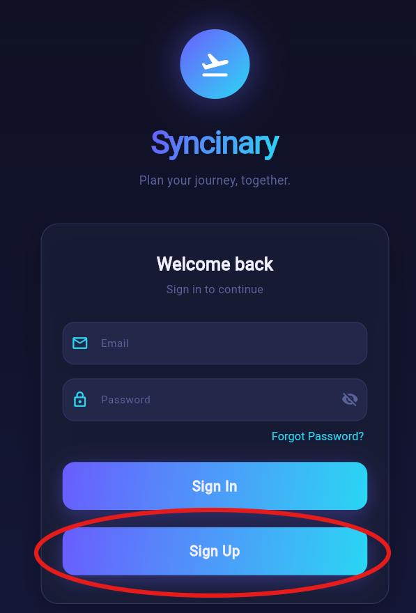
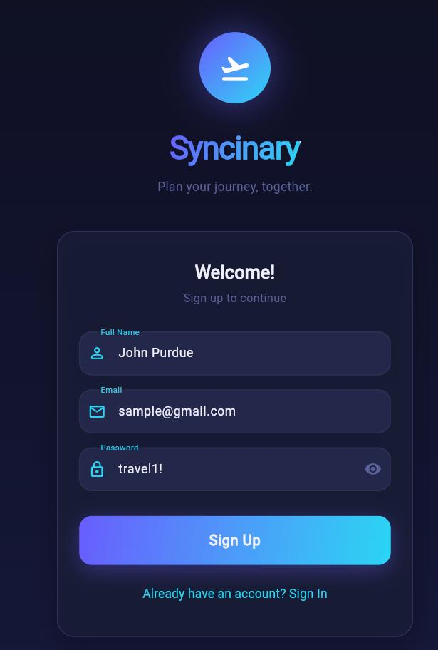
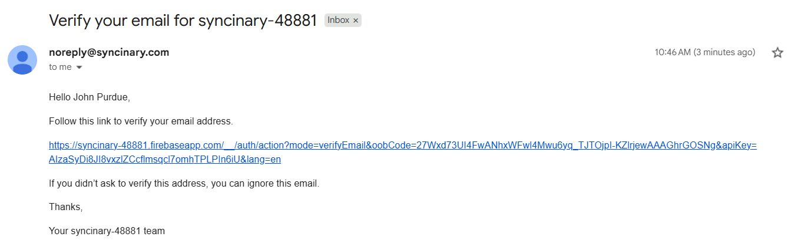
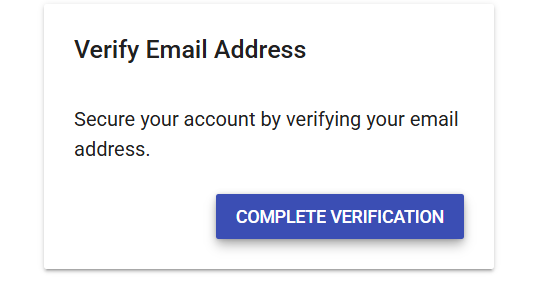
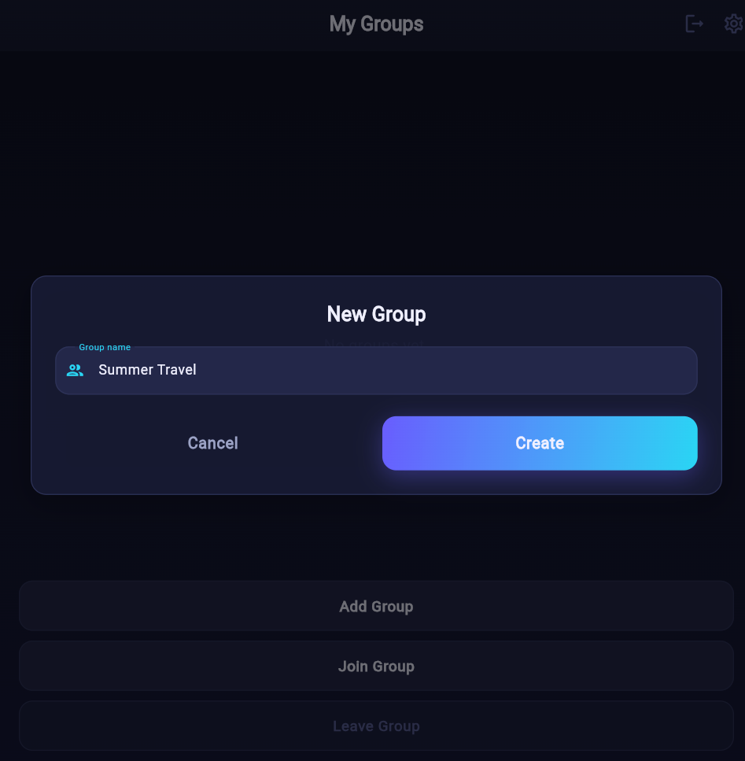
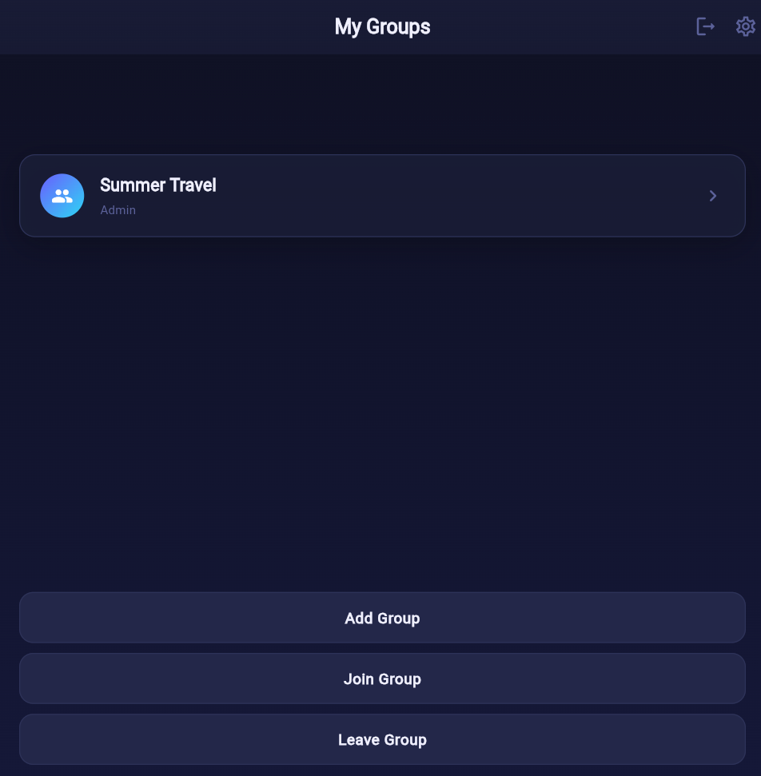
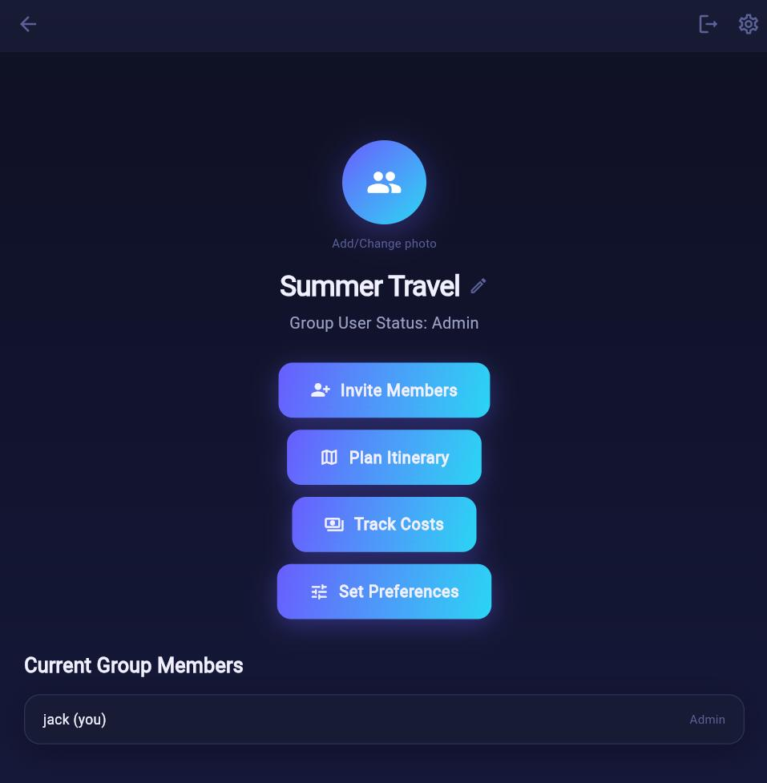

# Syncinary: Getting Started

## Overview

Syncinary is an application to make your group travel planning as simple as possible. After creating a group with friends or family, everyone can set their travel preferences, suggest flights, hotels, and activities, view AI trip suggestions powered by Gemini, and see their trip plan on a map view.

## Prerequisites

Syncinary Requirements
- An internet connection
- A valid email
- A travel ready group
## Setup
Go to <https://syncinary.com> using your favorite web browser
## Sign Up

1. Click the **Sign Up** button

   

2. Enter the fields below and click **Sign Up**

   - Name
   - A valid email address
   - A password at least 8 characters long with a letter, number, and special character

   

3. Next, you will see an email verification page.

   

   Check both your main inbox and spam for an email from <noreply@syncinary.com>

   

   The email may take up to 5 minutes to arrive. Clicking the link will bring up this screen:

   

   Click **COMPLETE VERIFICATION** and return to Syncinary and click the “Check Verification” button.

   

   After a short onboarding slideshow, you will be routed to the main page.

## Creating a Group

1. From the homepage, select “Add Group” to create a new group or “Join Group” to join an existing group.

   

2. If adding a new group: Enter in a group name and select “Create”

   

3. If joining an existing group, join using a code from a preexisting group

   

   Or, if previously invited, select the pending invite.

4. From here, select the group to be brought to the group homepage

   

## Expected Results

From here, you have options to invite more members, start planning a trip, track costs, and set your individual trip preferences

## Troubleshooting

### No verification email?

- First, check your spam folder. If not present, verify that the email on the email verification screen is correct. If so, click “Resend Email”.

### Forgot Password?

- On the login screen, select the “Forgot Password?” link to have a password reset link sent to your verified email.

### Cannot create new group?

- Ensure that the trip name field is populated with the name of your trip.

### My invite code does not work?

- Double check that the code you are giving/given is correct. If so, try inviting by utilizing the invite via email feature.

### The site crashes/will not run/ is locked on a screen

- Please help us out by opening a new issue here: [Issues](https://github.com/PrishaB/Syncinary/issues)
